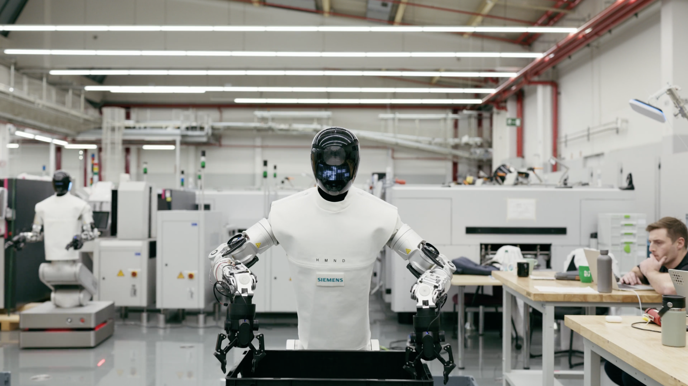
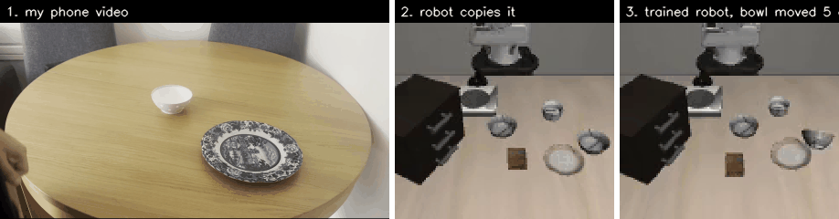
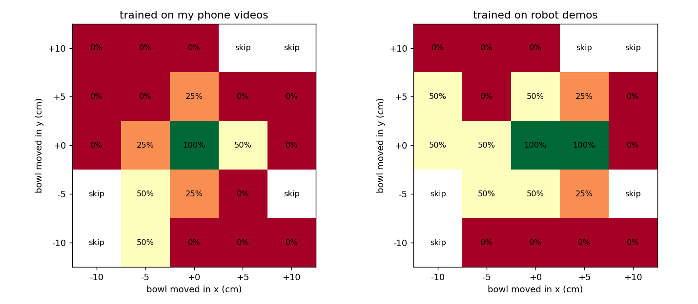
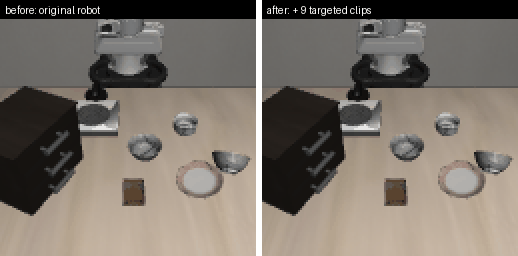
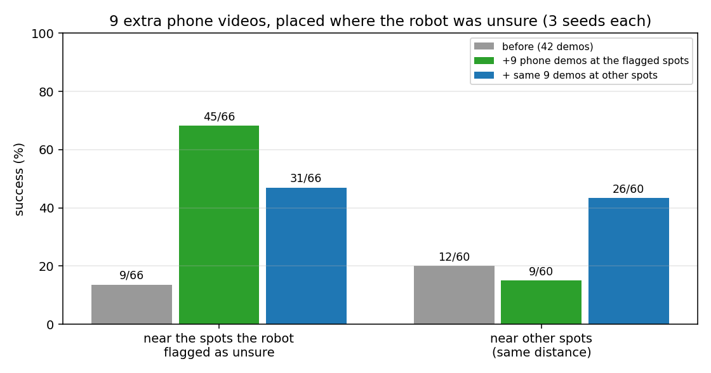
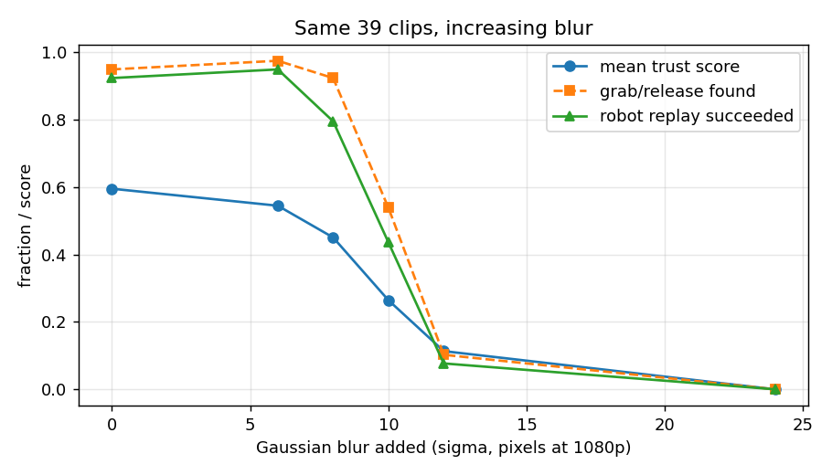

# Humanoid Internship Application: Teaching a Robot With My Phone, and Letting It Tell Me What to Film Next




Imagine a factory wants a humanoid robot to pick brackets from a bin and place them into a tray. Instead of spending weeks teleoperating the robot to collect demonstrations, workers could simply wear a phone camera while doing the job normally for an hour. Their hand movements could then be turned into training data for the robot.

The robot learns the task, but then the tray gets moved 10 cm to the left and it starts failing because it has not seen that situation before. If the robot can identify the situations where it is unsure, someone does not need to go out and record hundreds of extra clips at random. They could just record a small number of clips showing the exact situation the robot struggles with, then retrain it using those examples.

This project is a small version of that loop. I used my own phone, a bowl and a plate, and tested the idea in simulation:



*Left: one of my phone clips with the tracked hand. Middle: the same motion retargeted onto a Panda arm in LIBERO. Right: a policy trained on my clips (plus 9 extra clips aimed at its weak spots), picking up a bowl moved 5 cm from where it was in training.*

## TL;DR

I recorded 54 short phone clips of my hand performing the task. These were converted into 42 robot demonstrations, and 40 of them replayed successfully in LIBERO.

I then trained a policy using those demonstrations. Across 50 unseen layouts and 8 random seeds, the policy achieved a success rate of 91 ± 6%. For comparison, the same policy trained on 40 expert demonstrations from LIBERO achieved 92 ± 7%, so the demonstrations collected from phone videos performed about as well as the original expert data.

However, when I moved the bowl by around 5–10 cm, both policies started to fail much more often. For the policy trained using the phone demonstrations, I trained 7 separate copies of the policy and compared their predictions during the first few moves. When the policies disagreed with each other, this was a useful sign that the robot was likely to fail, with an AUROC of 0.80.

I then used this disagreement to decide where to collect more data. I recorded 12 more phone clips with the bowl in different spots, moving it in four directions at home. The 9 clips that worked were then placed by the program in the simulator at the three positions where the policies disagreed the most.

After adding these demonstrations, success near those positions increased from 14% to 68%, with 45 successful runs out of 66. As a comparison, when the same 9 clips were placed at other positions instead, success near the flagged positions only reached 47%, or 31 successful runs out of 66.

---

## How it works

```
phone video ──► MediaPipe hand landmarks ──► grab / release from thumb–index distance
           ──► map the hand path onto the table (grab point → bowl, release point → plate)
           ──► replay in LIBERO (records images + actions) ──► behaviour-cloning policy
```

I picked up the bowl using my thumb and index finger, which is similar to how the robot uses its two-finger gripper. The program measures the distance between my thumb and index finger throughout the video. When that distance becomes small, it treats that as a grab, and when the distance becomes larger again, it treats that as letting go. This tells the robot when it should close and open its gripper.

Because a single phone camera cannot measure real-world distance very accurately, and because my table is not the same size as the simulated environment, I did not try to directly copy the exact position of my hand. Instead, the program uses two important points from the demonstration: where I grabbed the bowl and where I let it go.

These two points are matched to the bowl and plate positions in the simulator. The hand movement between them is then adjusted so that the path fits between those two points in the simulated scene. This means the path can be stretched and rotated to match the simulator without needing to calibrate the phone camera to the simulated environment.

I also tracked the point between my thumb and index finger rather than my wrist. This is because the robot actually grabs objects with its gripper fingers, so the point between my fingertips is much closer to where the robot is making contact with the bowl. The wrist is several centimetres away from the actual grab point, so it would give a less accurate path.

The robot then replays the converted movement inside the simulator. During this replay, the simulator records what the robot's cameras see and the actions taken by the arm and gripper. These recorded demonstrations are then used as the training data for the policy.

**What comes from my video vs what is scripted**:

| From my video | Scripted / from the simulator |
|---|---|
| when I grab and release | height above the table (low near bowl/plate, high in between) |
| the path between bowl and plate | the last few cm straight down to grasp / release, then straight up |
| | grasp offset from the bowl centre (measured from 5 LIBERO expert demos) |
| | grasp height (found with a height sweep, `test_grasp.py`) |
| | gripper orientation (kept pointing down) |

The policy is trained on simulator images of the replayed motions, not on my phone images.

**Policy:** two ImageNet ResNet18 encoders (front + wrist camera) + end-effector position and gripper state → next 8 actions; executes 4, then predicts again. Checkpoint chosen on 10 separate validation layouts; final test on 50 different unseen layouts.

---

## Data

| Recorded | Grab/release found → replayed | Replay succeeded | Replay failed |
|---|---|---|---|
| 39 normal clips | 37 | 36 | 1 |
| 10 hard clips (fast / whole-hand grip) | 3 | 2 | 1 |
| 5 deliberate failures (dropped bowl) | 2 | 2* | 0 |
| **54** | **42** | **40** | **2** |
| 12 extra clips (Result 3) | 12 | 9 at target spots / 9 at other spots | 3 / 3 |

\* My retargeting always places the release on the plate, so it "corrected" my deliberate drops into successes.

I set up my phone on a tripod at around my eye level, so the camera saw the table roughly from my point of view. I used a bowl and a plate to mimic the LIBERO scene, and picked the bowl up with a pinch (my thumb and index finger) and placed it on the plate. I kept the phone, table and lighting the same for every clip, and moved the bowl’s starting position slightly each time.

---

## Result 1: phone demos vs robot demos

On 50 unseen test layouts, the policy trained on my 42 phone-derived demonstrations achieved an average success rate of 91%, while the same policy trained on 40 LIBERO expert demonstrations achieved 92%:

| Trained on | Success | Seeds |
|---|---|---|
| my 42 phone-derived demos | **91 ± 6%** | 94, 92, 100, 92, 96, 82, 80, 94 |
| 40 LIBERO expert demos | **92 ± 7%** | 84, 98, 96, 100, 98, 86, 84, 86 |

These results are basically equal. The difference between 91% and 92% is smaller than the normal variation between training runs, which is why I describe the phone-derived demonstrations as performing comparably to the LIBERO expert demonstrations rather than saying one is better or worse than the other.

The individual runs also varied quite a bit depending on the training seed. Some phone-trained policies performed better than some expert-trained ones, and some performed worse. Looking at the averages across all 8 seeds gives a much more reliable comparison than focusing on a single run.

It is also important to point out that these test layouts are still quite close to the original training setup. The objects are only moved by a few centimetres, so this result shows that the phone-derived demonstrations work about as well as the LIBERO demonstrations under small changes to the scene. It does not mean they will generalise equally well to much larger changes.

---

## Result 2: where it breaks, and whether it knows



Bowl moved up to ±10 cm (4 episodes per square; squares where the bowl would sit on the plate or stove are skipped).

| | episodes | success away from centre |
|---|---|---|
| phone-trained | 70 | 16% |
| expert-trained | 70 | 26% |

Disagreement between 7 policies (same data, different seeds) in the first few steps, as a failure predictor:

| | AUROC | success, least → most disagreement (quarters) |
|---|---|---|
| phone-trained | **0.80** | 44%, 0%, 12%, 6% |
| expert-trained | 0.44 | 17%, 39%, 18%, 29% |

Both policies struggled when the bowl was moved around 5–10 cm away from its usual position. This makes sense because, during training, the bowl was always placed close to the same area. Neither policy had seen much variation in where the bowl could start, so moving it further away created situations that were different from the ones they had learned from.

The phone-trained policy seemed to break down slightly sooner. Away from the centre, it succeeded in 16% of trials, compared with 26% for the policy trained on LIBERO expert demonstrations. One possible reason is that the retargeting process makes the grasp very consistent. In the phone-derived demonstrations, the robot always approaches the bowl in almost the same way and grabs it at the same point. This may make the demonstrations less varied than the expert data and could make the policy more sensitive when the bowl is moved.

I also tested whether disagreement between 7 independently trained policies could be used as a warning that the robot was likely to fail. This worked quite well for the phone-trained policies, with an AUROC of 0.80. In other words, when the policies disagreed more during the first few movements, failure was more likely.

The same warning signal did not work well for the policies trained on the LIBERO expert demonstrations, where the AUROC was only 0.44. This suggests that disagreement was useful for identifying weak areas in the phone-trained policy, but the same relationship was not present in the expert-trained policy.

These results should still be treated carefully because the sample is small. There were only 70 trials per policy, and the phone-trained policy succeeded in just 11 of them. So the results are useful evidence, but they are not enough to make a strong general claim.

---

## Result 3: letting the robot tell me what to film


I measured how much the 7 phone-trained policies disagreed with each other on the first frame at 8 different bowl positions, each around 5–7 cm away from the centre.

I picked the three positions with the highest disagreement as the target positions. I also randomly selected three other positions at the same distance to use as controls. I saved these choices (results/targets.json) before recording any new data, so the positions could not be changed based on the results later.

I then recorded 12 new phone clips with the bowl moved by around 5 cm in four different directions, while also varying how I reached for it. Nine of these clips replayed successfully in the simulator.

I trained two sets of policies using the same random seeds, with three runs for each. One used the original 42 demonstrations plus the 9 new demonstrations placed at the target positions. The other used the same original 42 demonstrations and the same 9 new demonstrations, but placed them at the control positions instead.

I tested the policies at positions 1.5 cm away from each of the chosen locations, so none of the exact test positions had been used for training. Each policy improved the most around the areas where its new training data had been placed.






| | near targets | near controls |
|---|---|---|
| before (42 demos) | 9/66 = 14% | 12/60 = 20% |
| + 9 clips at targets | **45/66 = 68%** | 9/60 = 15% |
| + same 9 clips at controls | 31/66 = 47% | **26/60 = 43%** |


Overall, the two approaches ended up performing about the same. The main benefit of targeting the high-disagreement positions was that it improved the specific areas where the original policy was weakest, rather than improving performance everywhere.

The policy that received the new demonstrations at random control positions also improved around the target positions, going from 14% success to 47%. This suggests that some of the improvement simply came from adding more demonstrations. However, placing the demonstrations specifically around the high-disagreement areas improved success there further.

These results are based on only three training runs for each approach, so they should not be treated as conclusive. On the normal test distribution, the targeted policies achieved 87% success compared with 95% for the control policies.

---

## What didn't work

**A tracking-confidence score.** I measured how much the tracker disagreed with itself (original vs mirrored vs zoomed frame) and how jumpy it was.



- It drops steadily as I blur the clips, and drops before replays start failing
- But within one blur level it can't tell which clips will fail (AUROC ≈ 0.55)
- v2 (do the three views agree on *when* the grab and release happen?) was frozen before testing on a held-out motion-blur set. On that set: "was a grab/release detected at all?" 0.96, v2 0.83, my v1 0.77, MediaPipe's own score 0.72. On the 16/227 clips where a grab was found but the replay still failed, no score was reliably better than MediaPipe

Most of the bad phone clips failed in an obvious way. For example, sometimes the hand tracker could not properly detect the grab at all. Because of this, a simple yes or no check of whether the program found a grab and release at all was enough to catch most of the bad examples. More complicated ways of scoring the quality of the tracking did not seem to add much.

I also tested whether keeping failed demonstrations could actually help the policy learn. With only 3 training seeds, keeping the two failed replays initially looked much better, with 95% success compared with 80% when they were removed. However, after increasing the experiment to 8 seeds, the difference became much smaller: 91% compared with 87%. That difference was within the normal variation between training runs, so I dropped the claim that failed demonstrations were helpful.

I tried weighting the training loss using the confidence of the hand tracking, so demonstrations with more reliable tracking would have more influence during training. This achieved 85 ± 8% success, compared with 91 ± 6% without the weighting, so it did not improve performance.

I also ran several control experiments with 3 seeds each. Simply duplicating good demonstrations achieved 85% success. Nudging the robot off course during replay, but recording the correct corrective actions, achieved 89%. Recording the nudged actions themselves instead achieved 92%. None of these differences were large enough to stand out from the normal variation between runs.

One of the main things I learned from these experiments was how much the result can change just from training the same policy again with a different random seed. With only around 40 demonstrations, success could vary by roughly 10 percentage points between runs. This meant that results based on only 3 seeds could look convincing at first but disappear when I tested more seeds, so I started using more runs before drawing conclusions.

---

## Mistakes I caught along the way

My first evaluation accidentally reused some of the same layouts that had been used during training. I fixed this by switching to fresh randomly generated layouts for the final tests.

I also found that training for too long caused the policy to memorise the training data rather than generalise well. For example, performance dropped to 0% after 15,000 training steps, even though it had reached 40% after only 300 steps. Because of this, I stopped choosing the final model based on the end of training and instead selected the best checkpoint using a separate set of validation layouts that were not used for training or final testing.

I also noticed that the policy would slowly twist the gripper while it was running. My phone demonstrations never included any gripper rotation, but small prediction errors could build up over time and cause the gripper to rotate anyway. For the phone-trained policies, I therefore lock the rotation to zero when running them. This keeps the robot closer to the type of movement it actually saw in the demonstrations.

There was also one mistake where a short 50-step sanity-check run accidentally overwrote the saved model for uniform seed 0, `uniform_s0.pt`. Because of this, the later moved-bowl experiment only uses seeds 1–7. The earlier 91% result is still valid because it was measured before that model file was overwritten.

---

## Limitations

- One task, one table, one bowl, one person, one phone
- Test layouts move objects only a few cm; policies fail beyond ~5 cm
- Parts of the motion are scripted (see table above), and one grasp-offset constant comes from expert demos
- Retargeting can't detect a dropped bowl
- 3 seeds for Result 3; 4 episodes per square in the heatmap

---

## Design choices

I used LIBERO because it was suggested in the challenge, and this task was a good fit for what I wanted to test. Moving a bowl onto a plate is simple enough to recreate at home using real objects, which made it easy to record phone demonstrations. LIBERO also provides expert robot demonstrations for the same task, so I could compare data collected from a phone against existing robot demonstrations in a fair way.

I used behaviour cloning rather than reinforcement learning or a larger vision-language-action model because I wanted something simple and fast to train. Each training run took around 25 minutes on my laptop GPU, which meant I could repeat the experiment many times with different random seeds. That turned out to be important because the results could vary by around 10 percentage points between runs. Reinforcement learning would have taken much longer, and because the behaviour cloning policy was already reaching around 90% success on the normal test layouts, there was not much room left for RL to improve the basic task.

I also kept the training, validation and final test layouts separate. I originally saw that testing on layouts that had already been used during training could make the results look better than they really were. The validation layouts are used to decide which checkpoint to keep during training, while the final test layouts are left untouched until the end. This gives a fairer measure of how well the policy works on layouts it has not seen before.

For the targeted data experiment, I chose the target and control positions before recording any new phone clips. This meant I could not change the positions later after seeing the results. I also saved them to a file before filming, so they were fixed before I saw any new results.

I used the exact same 9 new phone clips for both the targeted and control experiments. The only thing that changed was where those demonstrations were placed in the simulator. This was important because if I had recorded different clips for each condition, any difference in performance could have come from one set of clips simply being better than the other, rather than from where the new data was added.

---

## How to run

Tested on Ubuntu 24.04, RTX 4060 (8 GB). Two conda environments, because LIBERO needs Python 3.8 and MediaPipe needs a newer one.

```bash
# 1. LIBERO (python 3.8)
conda create -n libero python=3.8.13 -y && conda activate libero
git clone --depth 1 https://github.com/Lifelong-Robot-Learning/LIBERO.git && cd LIBERO
pip install -r requirements.txt && pip install -e . && pip install imageio imageio-ffmpeg

# 2. hand tracking (python 3.10)
conda create -n hands python=3.10 -y && conda activate hands
conda env config vars set PYTHONNOUSERSITE=1 && conda activate hands
pip install "mediapipe==0.10.21" "numpy<2" "opencv-python<4.11" "opencv-contrib-python<4.11" pillow matplotlib

# 3. copy this repo's .py files into the LIBERO folder; put clips in my_clips/<group>/ (e.g. my_clips/good/)
```

Pipeline, in order (run from the LIBERO folder):

| Step | Env | Command |
|---|---|---|
| track hands | hands | `python track_hands.py` |
| find grab / release | hands | `python find_events.py` |
| retarget + replay | libero | `python retarget.py` |
| tracking confidence | hands | `python uncertainty.py` then `python trust_v2.py` |
| train + test a policy | libero | `python train_eval.py uniform --seed 1` |
| moved-bowl test | libero | `python hard_eval.py uniform` then `python hard_plot.py` |
| pick target spots | libero | `python select_targets.py` |
| place new clips | libero | `python retarget.py <clips> --place=targets --outdir=new_targeted` |
| train + test targeted | libero | `python train_eval.py targeted --seed 1` then `python target_eval.py targeted 1` |

My phone clips (all 4 sets): [Google Drive folder](https://drive.google.com/drive/folders/1lkoRC1S6BNhrAwjoWP4jJFxn-LxL585j?usp=sharing)

---

## With another week

With another week, the first thing I would change is the grasping motion. At the moment, every retargeted demonstration approaches the bowl in almost the same straight-down way. I think this may be one reason why the phone-trained policy breaks down sooner than the expert-trained one when the bowl is moved. I would record demonstrations with different approach angles and see whether that makes the policy more robust.

I would also run more rounds of the same data collection loop. The idea would be to find the positions where the policies disagree most, record new demonstrations there, retrain the policies, and then repeat the process. I would also use more training seeds at each stage so the results are less affected by random variation between runs.

Another thing I would try is recording from a first-person view using a chest-mounted phone. This would be closer to the viewpoint a humanoid robot might have. It would also be a useful test of whether the same retargeting method still works when the camera itself is moving.

Finally, I would test the same idea with larger models, such as a vision-language-action model or a world model. I would be interested to see whether comparing several independently trained versions of a larger model could still help identify the situations where the robot is most uncertain about what to do.

My MSc project looks at a robot controller that needs to know when its own position estimate is unreliable. This challenge made me think about a similar question from the data side: when should a robot trust what it has learned from human video, and when should it recognise that it needs more examples?
